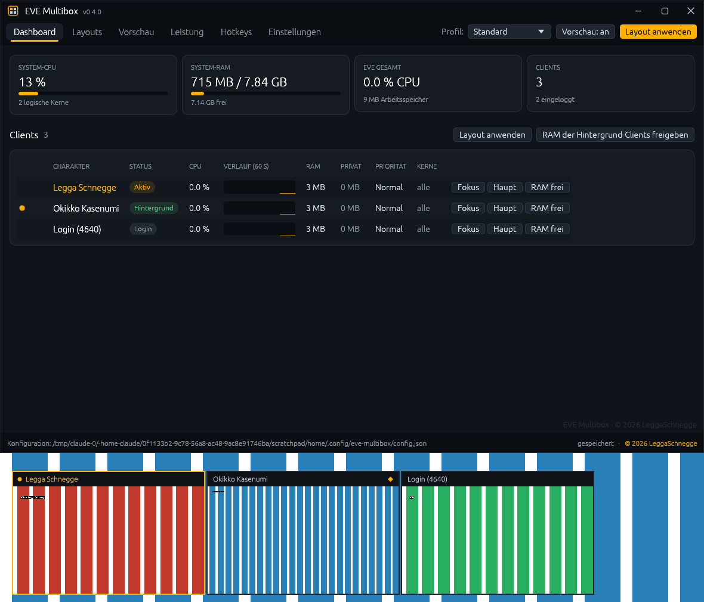

# EVE Multibox

Kostenloses Multibox-Werkzeug für EVE Online unter **Windows 11 und Linux** – in Rust, ohne Input-Broadcasting.
Ein Quellcode, zwei Programme: `eve-multibox.exe` (Windows) und `eve-multibox` (Linux, X11/XWayland).

**Version 0.4.0** · [Download (Releases)](https://github.com/Zer0C0ol1337/eve-multibox/releases/latest) ·
[Changelog](CHANGELOG.md) · MIT-Lizenz

© 2026 LeggaSchnegge · Fragen oder etwas Seltsames? → @[3THEL] LeggaSchnegge



## Download & Start

| System | Datei | Start |
|---|---|---|
| **Windows 10/11** | `eve-multibox-0.4.0-windows-x64.zip` | entpacken, `eve-multibox.exe` starten |
| **Linux** | `eve-multibox-0.4.0-linux-x86_64.tar.gz` | entpacken, `./eve-multibox --install`, dann übers Startmenü |

EVE muss im Fenstermodus laufen („Fenster“ oder „Fenster (fest)“). Einzelheiten zu Linux weiter unten.

**Virenscanner:** Ein einzelner Scanner (SecureAge) meldete bei VirusTotal einen Fehlalarm (1/68) – typisch für
neue, unsignierte Programme. Der komplette Quellcode liegt hier offen; wer mag, baut die `.exe` selbst.

## Funktionen

| Bereich | Funktionen |
|---|---|
| **Layouts** | Profile mit Hauptfenster- und beliebig vielen Nebenfenster-Plätzen, mehrere Monitore, Monitor-Vorlagen (Haupt + Raster, Haupt + Seitenleiste), „aktuelle Positionen übernehmen“, rahmenlos, automatisch anwenden beim Login, Hotkey zum Tauschen |
| **Live-Vorschau** | Live-Bilder aller Clients (wie EVE-O Preview; Windows: DWM, Linux: XComposite), Linksklick = fokussieren, Rechtsklick = ins Hauptfenster tauschen, Ziehen = verschieben (Position je Charakter gespeichert), aktiver Client hervorgehoben |
| **Hotkeys** | Nächster/vorheriger Client, Tauschen, Layout anwenden, Vorschau ein/aus, ein Hotkey pro Charakter – standardmäßig nur aktiv, wenn EVE vorne ist |
| **CPU** | Priorität und Kern-Affinität pro Charakter, Hintergrund-Clients drosseln (Priorität + eigene Kerne), inaktive Clients minimieren |
| **Speicher** | RAM pro Client (Working Set + Privat), Warnungen pro Client und für das System, Arbeitsspeicher freigeben (manuell oder automatisch für Hintergrund-Clients) |
| **Dashboard** | System-CPU/RAM, EVE-Summen, Tabelle aller Clients mit CPU-Verlauf, Status und Schnellaktionen |
| **Tray & Autostart** | Symbol im Infobereich mit Menü, X blendet ins Tray aus, Start mit Windows (direkt im Tray), Zweitstart holt das vorhandene Dashboard nach vorne |
| **Sprachen** | Deutsch, English, Français, Русский, Español, 简体中文 – automatisch nach Systemsprache oder fest wählbar (Chinesisch nutzt eine Systemschrift, z. B. Microsoft YaHei bzw. Noto CJK) |
| **Hotkeys aufnehmen** | Knopf „Aufnehmen“ neben jedem Hotkey-Feld – einfach die Kombination drücken |
| **Design** | Eigene Titelleiste, dunkles EVE-Design mit orangem Akzent, Vorschau-Titel mit Markierung für aktiven Client und Hauptfenster |

## Linux

Läuft mit EVE über Steam/Proton oder Lutris auf **X11** und auf **Wayland mit XWayland** (Standard bei KDE Plasma und
GNOME – EVE läuft dort selbst als XWayland-Fenster). Funktionsumfang wie unter Windows: Layouts, Live-Vorschau
(XComposite), Hotkeys, Drosselung, Speicher-Werkzeuge, Dashboard, Tray, Autostart, alle Sprachen.

```bash
tar xzf eve-multibox-0.4.0-linux-x86_64.tar.gz && cd eve-multibox-0.4.0-linux-x86_64
./eve-multibox --install                       # Startmenü-Eintrag + Icon (ohne sudo), --uninstall entfernt alles
sudo setcap cap_sys_nice+ep ./eve-multibox     # optional: Priorität erhöhen/zurücksetzen + Speicher auslagern
```

- **Voraussetzung:** glibc ≥ 2.30 (Ubuntu 20.04+, Debian 11+, Fedora, Arch, Mint 20+, SteamOS im Desktop-Modus).
- **Rechte:** Ohne `cap_sys_nice` kann Linux die Priorität nur *senken* – Drosseln geht, Zurücksetzen nicht vollständig.
  Der Leistung-Tab zeigt den Status und den passenden `setcap`-Befehl (mit Kopierknopf). Nach jedem Update erneut setzen.
- **Speicher freigeben** nutzt `process_madvise(MADV_PAGEOUT)` (Kernel ≥ 5.10) und lagert Seiten in Swap/zram aus.
- **Tray:** über StatusNotifierItem – KDE, Xfce, Cinnamon, MATE, LXQt; GNOME braucht die Erweiterung „AppIndicator“.
  Ohne Tray schließt X das Programm wirklich.
- **Reines Wayland** (ohne XWayland) erlaubt Fremdprogrammen weder Fenster zu verschieben noch Vorschaubilder – die
  Einstellungen zeigen dann einen Hinweis.
- Konfiguration: `~/.config/eve-multibox/config.json`, Protokoll daneben. Autostart: `~/.config/autostart/`.
- Befehle: `--install`, `--uninstall`, `--minimized`, `--version`, `--help`.

## Regelkonformität

CCP verbietet Input-Broadcasting und -Multiplexing: Eine Eingabe darf nicht auf mehrere Clients wirken.
EVE Multibox **sendet niemals Tastatur- oder Mauseingaben an EVE**. Es nutzt nur Windows-Funktionen:

- Fenster verschieben/vergrößern (`SetWindowPos`), fokussieren (`SetForegroundWindow`), minimieren
- Vorschaubilder über den Desktop Window Manager (`DwmRegisterThumbnail`) – dieselbe Technik wie EVE-O Preview
- Prozess-Priorität und Kern-Affinität, Arbeitsspeicher freigeben (`EmptyWorkingSet`)
- Globale Hotkeys (`RegisterHotKey`): Ein Tastendruck löst genau eine Fensteraktion aus

Damit bleibt jeder Tastendruck im Spiel beim aktiven Client. Die Verantwortung für die Einhaltung der aktuellen EULA bleibt trotzdem beim Spieler – im Zweifel CCP fragen.

## Entwicklung unter WSL + VS Code

Gebaut wird in WSL als Cross-Compile direkt zu einer Windows-`.exe` (Ziel `x86_64-pc-windows-gnu`).

```bash
# einmalig: Windows-Target + MinGW-Linker installieren
scripts/dev.sh setup

# Unit-Tests der Kernlogik (laufen nativ unter Linux)
scripts/dev.sh test        # oder: cargo t

# Debug-Build, nach C:\Users\<du>\EveMultibox kopieren und starten
scripts/dev.sh run

# Release-Build (klein, ohne Konsolenfenster) → dist/ und C:\Users\<du>\EveMultibox
scripts/dev.sh release

# Tests + Clippy für beide Backends (Windows wird unter Linux typgeprüft)
scripts/dev.sh check

# Linux: einmalig zig + cargo-zigbuild, dann Paket bauen → dist/eve-multibox-<version>-linux-x86_64.tar.gz
scripts/dev.sh setup-linux
scripts/dev.sh linux

# Linux-Version mit simulierten EVE-Clients ausprobieren (WSLg unter Windows 11 reicht)
scripts/dev.sh demo-linux
```

- `.cargo/config.toml` setzt Windows als Standardziel – `cargo build` liefert also immer die `.exe`.
- `.vscode/settings.json` stellt rust-analyzer auf das Windows-Ziel ein. Empfohlene Erweiterungen: *rust-analyzer*, *WSL*.
- `cargo ck` prüft den Code schnell ohne Windows-Linker.
- Der Debug-Build öffnet zusätzlich ein Konsolenfenster (praktisch für Panics), der Release-Build nicht.

Unter Windows liegt die Konfiguration unter `%APPDATA%\EveMultibox\config.json` und wird bei jeder Änderung automatisch gespeichert.
Daneben liegt `eve-multibox.log` (Startprotokoll, Absturzdetails).

`build.rs` bettet beim Windows-Build Icon und Versionsinfos (Copyright LeggaSchnegge) per `windres` in die `.exe` ein.

**Neue Sprache hinzufügen:** in `src/i18n.rs` eine Spalte ergänzen – `cargo t` meldet jeden fehlenden Text.

## Release veröffentlichen

1. Version in `Cargo.toml` erhöhen, `CHANGELOG.md` und diese README anpassen, committen und pushen.
2. Auf GitHub **Releases → Draft a new release**, Tag `vX.Y.Z` (gleich der Version in `Cargo.toml`) neu anlegen,
   Text einfügen, **Publish release**.
3. GitHub Actions (`.github/workflows/release.yml`) baut Windows-ZIP und Linux-Paket und hängt sie nach einigen
   Minuten an das Release. Passt der Tag nicht zur Version, bricht der Ablauf mit einer klaren Meldung ab.

## Projektaufbau

```
src/
  lib.rs          Bibliothek „evemb“: plattformunabhängige Logik (testbar unter Linux)
  engine_api.rs   gemeinsame Typen zwischen Oberfläche und Engine (Befehle, Ereignisse, Snapshot)
  platform.rs     Fassade: Start, Sprache, Einzelinstanz, Monitore, Autostart – je Betriebssystem
  config.rs       Konfiguration, Laden/Speichern, Kern-Masken
  hotkey.rs       Parser „Ctrl+Shift+F1“ → Modifier + Virtual-Key
  i18n.rs         Texte in 6 Sprachen (Tests prüfen Vollständigkeit und Platzhalter)
  icon.rs         App-Icon per Code (Fenster, Tray, .exe)
  layout.rs       Charakter aus Titel, Reihenfolge, Platzvergabe, Vorlagen, Einrasten
  main.rs         Start: DPI, Sprache, Einzelinstanz, Dashboard
  diag.rs         Startprotokoll und Absturzbericht
  engine.rs       Engine-Thread: Clients, Hotkeys, Drosselung, Layouts, Snapshot
  tray.rs         Symbol im Infobereich mit Menü
  preview.rs      Vorschaufenster mit DWM-Thumbnails, Ziehen, Größe ändern, Andocken
  procstat.rs     CPU-Zeit, Speicher, Priorität, Affinität, Speicher freigeben
  win.rs          Fenster finden/fokussieren/verschieben, Monitore
  ui/             egui-Oberfläche (Dashboard, Layouts, Vorschau, Leistung, Hotkeys, Einstellungen)
  linux/          Linux-Backend: engine, x11 (EWMH), preview (XComposite/XRender), keys (XGrabKey),
                  procstat (/proc, nice, sched_setaffinity, process_madvise), tray (StatusNotifierItem),
                  signal (Tray/Signale → Engine), platform (XDG, Autostart, --install)
examples/
  fake_eve.rs     simulierte EVE-Clients für Tests unter Linux/WSLg
```

`build.rs` wählt das Backend: Windows → `win_backend` (engine.rs, preview.rs, tray.rs, …), Linux → `x11_backend`
(`src/linux/`). Mit `EVEMB_CHECK_WINDOWS=1` wird das Windows-Backend auch unter Linux typgeprüft.

Die Engine läuft in einem eigenen Thread (Windows: eigene Win32-Nachrichtenschleife, Linux: poll auf X11-Verbindung und Weck-eventfd). Die Oberfläche schickt ihr Befehle
über einen Kanal und liest den Zustand aus einem geteilten Snapshot. Beim Beenden setzt die Engine Priorität und
Affinität aller Clients auf die Ausgangswerte zurück.

## Gut zu wissen

- **EVE im Fenstermodus starten** („Fenster“ oder „Fenster (fest)“). „Fenster (fest)“ ist bereits rahmenlos.
- **Adminrechte:** Läuft EVE als Administrator, darf EVE Multibox Priorität/Affinität nicht ändern – das Dashboard zeigt dann „Keine Rechte“. Lösung: beide gleich starten.
- **Minimierte Clients** liefern kein Vorschaubild (schwarz) – Windows-Einschränkung.
- **Speicher freigeben** verschiebt Seiten in die Standby-Liste. Braucht der Client sie wieder, lädt er nach (kurzes Ruckeln). Gut für Hintergrund-Clients, nicht für den aktiven im Kampf.
- **Mehr als 64 logische Kerne** (Prozessorgruppen) werden nicht unterstützt.
- **Hotkeys** werden von Windows abgefangen und erreichen EVE nicht – Kombinationen wählen, die im Spiel frei sind.
